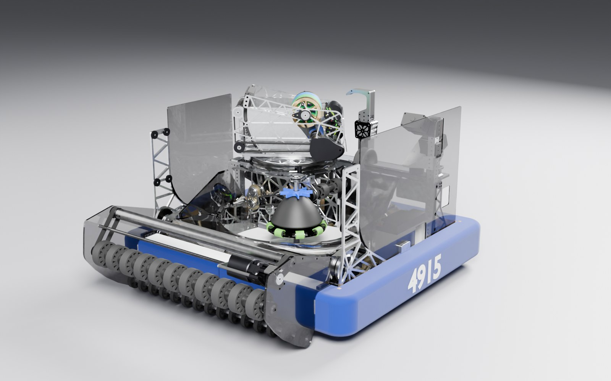
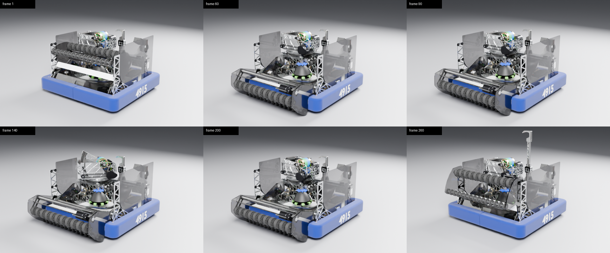

# ARTEMIS in Blender

A rigged, render-ready Blender scene of FRC 4915 Spartronics' 2026 robot **ARTEMIS**.
It is built from the Onshape glTF exports the team made for AdvantageScope.
Every mechanism moves from one set of sliders, in the same units the robot code uses.



| File | What it is |
| --- | --- |
| `ARTEMIS.blend` | The scene (~44 MB, Git LFS). Open with **Blender 5.2 LTS** or newer. GitHub does not store LFS files in forks, so this file is **not committed in `natebrix/2026-Rebuilt`**. To get it, build it (see [Rebuilding](#rebuilding), ~35 s). |
| `build_artemis.py` | Rebuilds `ARTEMIS.blend` from `source/`: import, cleanup, rig, materials, studio, demo animation. |
| `materials.py` | Procedural material library and the rules that map each part to a material. |
| `render_previews.py` | Renders a still of any pose or animation frame from the command line. |
| `artemis_joints.json` | Every joint's parent, origin, axis and control property, for simulation or other tools. |
| `source/` | Input GLBs: a copy of `assets/Robot_Artemis` from the `unstable` branch. This is the export of May 19 2026, commit `1368dc9`. The files are byte-identical to those on `unstable`, so git stores them only once. |
| `previews/` | Example renders, including a contact sheet of the demo animation. |

In a repository that stores `ARTEMIS.blend` in LFS, the file may be a ~130-byte text file after cloning. That is the LFS pointer, not the file. Fetch the real file with:

```bash
git lfs install
```

```bash
git lfs pull
```

## Using the rig

* **Units and axes.** The model uses the WPILib robot frame: **+X forward, +Y left, +Z up**, in metres. The origin is on the floor at the centre of the drive base.
* **Controls.** Select the **`ARTEMIS`** empty in the `ARTEMIS › Rig` collection and open *Object Properties › Custom Properties*. Every slider below drives a joint. To keyframe one, hover over it and press `I`.
* **Driving the robot.** Move or rotate the `ARTEMIS` empty itself to drive the robot around. Every part follows.
* **Python not required.** The drivers are plain expressions, so they work with *Auto Run Python Scripts* turned off.

| Property | Units / range | Meaning |
| --- | --- | --- |
| `intake_pivot_deg` | −2 … 132 ° | Matches `PivotSubsystem`. **130 = STOW** (CAD pose, the default), 60 = SAFE, 0 = READY (deployed). |
| `turret_deg` | −170 … 225 ° | Matches `TurretSubsystem`. Counter-clockwise (CCW) from robot-forward. |
| `hood_deg` | 0 … 40 ° | Matches `HoodSubsystem`. 0 = down. The hood pivots on the flywheel shaft. |
| `climber_m` | 0 … 0.28 m | Climber extension. The 0.28 m travel is an estimate; see the notes below. |
| `spindexer_deg` | ° | Spindexer rotation, CCW seen from above. |
| `steer_FL/FR/BL/BR_deg` | ° | Swerve module azimuth, CCW. 0 = wheel rolling straight forward. |
| `drive_FL/FR/BL/BR_deg` | ° | Wheel rotation; positive rolls the robot forward. Distance = radians × 0.0508 m. |
| `intake_rollers_deg` | ° | All intake rollers. |
| `shooter_wheels_deg` | ° | Flywheel stack and shooter rollers. |
| `feeder_rollers_deg` | ° | Feeder rollers under the turret. |
| `bumper_blue` | 0 … 1 | 0 = red bumpers, 1 = blue (the default, as in the team photo). |

**Making things spin.** Keyframe the `*_deg` properties with *linear* interpolation. For example, 3,600° over 30 frames is 10 rev/s at 30 fps.

**Roller speed and direction.** Each roller group is an empty named `J_roller_*`, and each has a `ratio` custom property (default 1). Set it negative to reverse that roller, or change it to set its speed relative to the control.

**Demo animation.** The file includes a 10-second action, **`Demo_Mechanisms`** (300 frames at 30 fps). It deploys the intake, aims, raises the hood, steers, spins up and climbs. To pose by hand, unlink it in the Action editor.



## Rendering

The `Studio` collection holds:

* a floor,
* three area lights,
* the cameras `CAM_Hero`, `CAM_Front`, `CAM_Side`, `CAM_RearHigh` and `CAM_Top`.

To use your own environment, hide or delete the collection.

Render settings:

* The default engine is Cycles at 128 samples with denoising, and the colour transform is AgX.
* EEVEE also works. For the smoked polycarbonate, turn on *Raytracing* in the EEVEE render settings.

To render a still from the command line, run this from this folder with `blender` on your PATH:

```bash
blender -b ARTEMIS.blend --python render_previews.py -- --out shot.png --camera CAM_Hero --samples 128 --pose intake_pivot_deg=0 turret_deg=45 hood_deg=20
```

`--frame N` renders a frame of the demo animation instead of a fixed pose. `--engine workbench --color-by joint` gives a quick clay render that colours each part by the joint it follows.

## Rebuilding

Rebuild after re-exporting the CAD, or after changing the material rules. A build takes about 35 seconds. Use either Blender:

```bash
blender --background --python build_artemis.py -- --out ARTEMIS.blend --report artemis_joints.json
```

or the `bpy` module from PyPI:

```bash
pip install bpy==5.2.4
```

```bash
python build_artemis.py --out ARTEMIS.blend --report artemis_joints.json
```

Options:

| Option | Effect |
| --- | --- |
| `--keep-hardware` | Keep screws, nuts, rivets and washers (+~650k triangles). Useful for close-ups. |
| `--assets DIR` | Read the GLBs from another folder (default: `source/`). |
| `--team-number N` | Text for the bumper numbers (default `4915`; `''` for none). |
| `--no-rollers` | Don't rig spinning rollers. |
| `--no-studio` | Skip the floor, lights and cameras. |
| `--no-demo` | Skip the demo animation. |

**Re-exporting from Onshape.** The script expects the same layout as the AdvantageScope export:

* `model.glb`: everything static
* `model_0.glb`: intake arm
* `model_1.glb`: turret and shooter
* `model_2.glb`: hood
* `model_3.glb`: spindexer

If the layout changes, edit `COMPONENT_FILES` at the top of `build_artemis.py`.

**Changing materials.** Edit `materials.py`:

* `NAME_RULES` maps part names to material types.
* `PHOTO_OVERRIDES` and `COLOR_OVERRIDES` handle one-off fixes.
* Colours such as `BUMPER_BLUE` and `SMOKE_TINT` are at the top of the file.

## How it was built and how accurate it is

* **Geometry.** The geometry comes from the team's AdvantageScope GLBs (Onshape export, May 19 2026). Parts are named as in Onshape and grouped into collections by subsystem. Hardware (791 screws, nuts, rivets and washers) and CAD helper cubes are removed.
* **Moving parts.** The team had already split the intake arm, turret/shooter, hood and spindexer into separate files. The build script also moves the following parts, picked out by name:
  * the turret gear and inner bearing race,
  * the climber's inner tube and hook,
  * each swerve module's turret assembly and wheel.

  Spinning rollers are found automatically. Each wheel is grouped with the shafts, pulleys and hubs on its axis.
* **Pivots and limits.** These come from the robot code on the `unstable` branch, using the `Pose3d` each subsystem logs for AdvantageScope:
  * intake pivot (0.2842, 0, 0.1825),
  * turret (−0.1183, −0.1437, 0.3623),
  * spindexer (0.0472, 0, 0.0619).

  The hood's logged pose uses an offset reference point. The true pivot it implies is the flywheel shaft at (y, z) = (−0.0975, 0.4953), and that is what the rig uses. Swerve axes come from the geometry: the modules sit at (±0.264, ±0.289). Limits are taken from the code's clamps.
* **Materials.** Materials come from the part names, the Onshape colours, and the team photo. That covers the smoked polycarbonate walls, blue bumpers with white numbers, the brass/blue/green flywheel stack, black prints, and machined aluminium plate and tube.

### Known limitations

* **Climber travel.** The 0.28 m travel is estimated from the tube lengths, because the climber code has been removed.
* **Not in the CAD.** These parts of the real robot are missing: the front smoked panel with the ARTEMIS logo, the sponsor decals, wiring and cable sleeves.
* **Guessed materials.** Some team-made parts are guesses from their CAD colour. For example, white CAD parts became white HDPE or white prints.
* **Mechanism motion.** All roller ratios are 1. Belts and chains don't animate.
* **Triangle count.** The scene has 2.5 M triangles, which is fine for stills and animation. For real-time use or physics, decimate the meshes or build simple collision shapes.
* **Newer CAD versions.** The model is the May 2026 export. The newer public Onshape share (version `d5fdcfd9…`) may differ; to use it, export the same five files and rebuild.

## Simulation

`artemis_joints.json` lists every joint:

* type (revolute or prismatic),
* parent,
* origin in the robot frame,
* axis,
* the control property and how it converts to an angle.

Each `J_*` empty's children are the rigid parts that move with that joint. That's what a URDF or MJCF exporter needs; export one mesh per joint from Blender and you're most of the way there.
